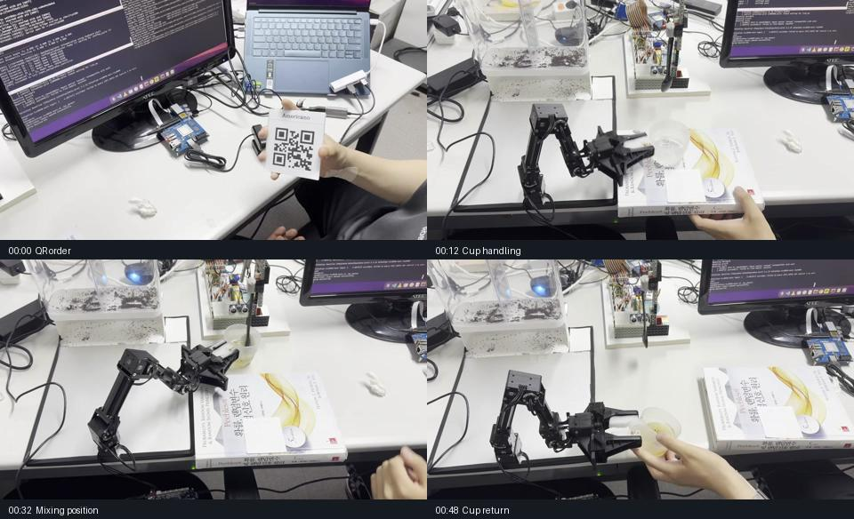
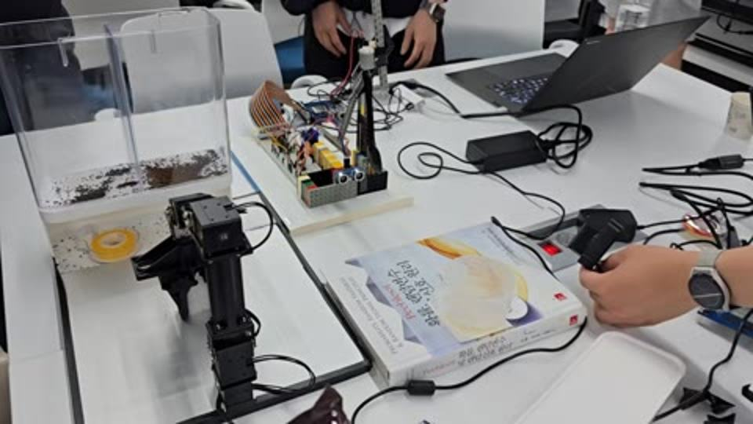
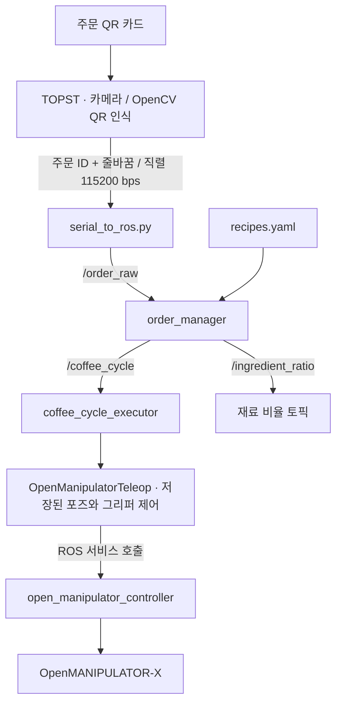

# TOPST Cafe Manager

**텔레칩스(Telechips)의 TOPST 보드, OpenMANIPULATOR-X, ROS 1 Noetic을 연결한 QR 주문 기반 카페 매니저 프로젝트입니다.**

카메라로 주문 QR을 읽고, 주문에 해당하는 레시피를 선택해 로봇 팔의 동작 순서를 실행합니다. OpenMANIPULATOR-X의 기존 텔레오퍼레이션 코드를 확장해 컵 이송과 작업 위치 이동을 자동 시퀀스로 구성했습니다.

## 시연 결과

### 최종 시연

아메리카노 주문 QR 제시부터 컵 이송, 교반 위치 이동, 컵 반환까지 이어지는 시연입니다. 컵과 작업 장치를 배치한 프로토타입 환경에서 동작을 확인했습니다.



| 장면 | 확인 내용 |
| --- | --- |
| 주문 입력 | `Americano` QR 카드를 카메라에 제시 |
| 컵 이송 | 그리퍼로 컵을 잡고 미리 설정한 작업 위치로 이동 |
| 작업 진행 | 재료 처리 위치를 거쳐 교반 장치 아래로 컵 이동 |
| 컵 반환 | 작업 후 컵을 다시 옮겨 사용자가 받을 수 있는 위치로 이동 |

### 테스트

TOPST 보드, 로봇 팔, 카메라와 작업 장치를 연결하고 QR 입력 및 컵 취급 동작을 점검한 테스트 기록입니다.



| 구분 | 원본 영상 | 길이 |
| --- | --- | --- |
| 테스트 영상 | `KakaoTalk_20250613_214304527.mp4` | 약 2분 40초 |
| 최종 시연 영상 | `KakaoTalk_20250613_023744338.mp4` | 약 49초 |

README에는 두 영상에서 추출한 장면을 수록했습니다.

## 주요 구현 내용

- **QR 주문 입력**: OpenCV로 QR을 해독하고 주문 ID를 직렬 통신으로 전달
- **TOPST–ROS 연동**: 줄바꿈으로 구분한 직렬 데이터를 ROS 주문 토픽으로 변환
- **레시피 관리**: YAML에서 메뉴별 동작 순서와 재료 비율 설정을 분리
- **자동 동작 실행**: 주문별 포즈 번호를 순서대로 실행하고 그리퍼 제어
- **수동 조정**: 기존 키보드·조이스틱 텔레오퍼레이션 기능 유지
- **통신 복구**: 직렬 연결이 끊어지면 브리지에서 포트 재연결 시도

## 시스템 구성



| 구성 요소 | 역할 |
| --- | --- |
| TOPST 보드·카메라 | QR 해독 및 주문 문자열 직렬 송신 |
| ROS 호스트 | 직렬 수신, 레시피 선택, 동작 순서 실행 |
| OpenMANIPULATOR-X | 컵 파지·이송, 작업 위치 정렬, 컵 반환 |
| 작업 장치 | 영상에 나타난 재료 처리·교반 시연 장치 |

`ingredient_ratio`는 레시피의 재료 설정을 발행하는 인터페이스입니다. 현재 저장소에는 이 토픽을 받아 별도 재료 장치를 구동하는 노드는 포함돼 있지 않습니다.

## 주문 및 레시피

QR에는 메뉴 이름 대신 `0`~`3`의 주문 ID를 넣습니다. `order_manager`는 이 ID를 [recipes.yaml](omx_ws/src/order_manager/config/recipes.yaml)의 키와 대조합니다.

| 주문 ID | 메뉴 | coffee | sugar | creamer | cocoa |
| --- | --- | ---: | ---: | ---: | ---: |
| `0` | Americano | 30 | 6 | 8 | 0 |
| `1` | Latte | 20 | 4 | 10 | 0 |
| `2` | Mocha | 25 | 5 | 8 | 2 |
| `3` | Cappuccino | 28 | 5 | 7 | 1 |

위 숫자는 YAML에 저장된 재료 설정값이며, 코드에 g·mL 같은 물리 단위는 지정돼 있지 않습니다. 최종 시연 영상에서 확인한 주문은 아메리카노입니다.

아메리카노의 동작 순서는 다음과 같습니다.

```yaml
recipes:
  "0":
    name: americano
    sequence: [1, 2, 3, 1, 7, 1, 7, 1, 8, 1, 4, 0]
    ratios: { coffee: 30, sugar: 6, creamer: 8, cocoa: 0 }
```

`sequence`의 숫자는 [open_manipulator_teleop_core.cpp](omx_ws/src/open_manipulator_controller/open_manipulator_teleop/src/open_manipulator_teleop_core.cpp)에 정의된 포즈 명령입니다. 실행기는 각 명령 뒤에 2.5초를 기다리며, `8`번 명령 이후에는 15초를 추가로 기다립니다. 일부 포즈에는 그리퍼 조작과 별도 대기 시간도 포함됩니다.

메뉴별 동작 순서는 YAML에서, 실제 관절 각도와 그리퍼 동작은 C++ 코드에서 조정합니다.

## ROS 인터페이스

### 토픽

| 토픽 | 타입 | 발행 → 구독 |
| --- | --- | --- |
| `/order_raw` | `std_msgs/String` | 직렬 브리지 → 주문 매니저 |
| `/coffee_cycle` | `std_msgs/String` | 주문 매니저 → 동작 실행기 |
| `/ingredient_ratio` | `std_msgs/String` | 주문 매니저 → 외부 확장용 |
| `/joint_states` | `sensor_msgs/JointState` | 컨트롤러 → 텔레오퍼레이션 코어 |
| `/kinematics_pose` | `open_manipulator_msgs/KinematicsPose` | 컨트롤러 → 텔레오퍼레이션 코어 |

### 주요 제어 서비스

- `/goal_joint_space_path`: 저장된 관절 목표로 이동
- `/goal_joint_space_path_from_present`: 현재 관절 상태에서 상대 이동
- `/goal_task_space_path_from_present_position_only`: 작업 공간에서 상대 위치 이동
- `/goal_tool_control`: 그리퍼 제어

## 저장소 구성

```text
TOPST_Cafe_Manager/
├── omx_ws/
│   ├── src/
│   │   ├── order_manager/
│   │   │   ├── config/recipes.yaml
│   │   │   ├── scripts/serial_to_ros.py
│   │   │   ├── src/order_manager.cpp
│   │   │   ├── src/qr_detect.cpp
│   │   │   └── launch/
│   │   ├── open_manipulator_controller/
│   │   │   ├── open_manipulator_controller/
│   │   │   ├── open_manipulator_teleop/
│   │   │   ├── open_manipulator_libs/
│   │   │   └── open_manipulator_description/
│   │   └── 외부 ROBOTIS 패키지 참조
│   ├── build/                     # 기존 개발 환경의 빌드 산출물
│   └── devel/                     # 기존 개발 환경의 실행 환경
└── docs/images/                   # 테스트·최종 시연 영상 캡처
```

| 주요 코드 | 설명 |
| --- | --- |
| [qr_detect.cpp](omx_ws/src/order_manager/src/qr_detect.cpp) | QR 해독과 직렬 송신. 현재 활성 구현은 ROS 토픽을 직접 발행하지 않음 |
| [serial_to_ros.py](omx_ws/src/order_manager/scripts/serial_to_ros.py) | 직렬 데이터를 줄 단위로 분리하고 주문 토픽 발행 |
| [order_manager.cpp](omx_ws/src/order_manager/src/order_manager.cpp) | 주문 ID를 레시피와 매핑하고 동작 순서·재료 설정 발행 |
| [coffee_cycle_executor.cpp](omx_ws/src/open_manipulator_controller/open_manipulator_teleop/src/coffee_cycle_executor.cpp) | 동작 순서를 해석해 `setGoal()` 호출 |
| [open_manipulator_teleop_core.cpp](omx_ws/src/open_manipulator_controller/open_manipulator_teleop/src/open_manipulator_teleop_core.cpp) | 커스텀 포즈와 그리퍼 제어 |
| [order_manager.launch](omx_ws/src/order_manager/launch/order_manager.launch) | 레시피 로드, 직렬 브리지, 주문 매니저 실행 |

## 개발 환경

| 구분 | 구성 |
| --- | --- |
| 임베디드 보드 | Telechips TOPST |
| 로봇 팔 | ROBOTIS OpenMANIPULATOR-X |
| ROS | ROS 1 Noetic · catkin |
| 언어 | C++, Python 3 |
| QR 처리 | OpenCV |
| 직렬 통신 | Linux 직렬 포트, PySerial |
| 설정 파일 | YAML |
| 로봇 제어 의존성 | OpenManipulator 메시지·라이브러리, Robotis Manipulator, Dynamixel 관련 패키지 |

`order_manager`의 빌드 설정은 OpenCV와 ZBar 개발 라이브러리도 요구합니다.

## 빌드 및 실행

### 1. 소스와 의존성 준비

```bash
git clone https://github.com/KweonTJ/TOPST_Cafe_Manager.git
cd TOPST_Cafe_Manager/omx_ws
source /opt/ros/noetic/setup.bash
```

현재 저장소의 `dynamixel-workbench`, `open_manipulator_msgs`, `robotis_manipulator`, `open_manipulator_simulations`는 외부 저장소 커밋을 가리키는 Git 참조이며, 루트 `.gitmodules`는 없습니다. clone 후 이 폴더들의 실제 소스가 준비됐는지 확인해야 합니다.

ROBOTIS 의존성 목록은 [openmanipulator.repos](omx_ws/src/open_manipulator_controller/openmanipulator.repos)에 있습니다. ROS 1 Noetic과 호환되는 소스 또는 설치 패키지를 준비한 뒤 빌드합니다. Gazebo 시뮬레이션을 사용할 경우에는 시뮬레이션 패키지도 준비합니다.

기존 `build`·`devel`과 분리된 경로에 빌드하는 예시입니다.

```bash
# 현재 위치: TOPST_Cafe_Manager/omx_ws
catkin_make --build build_noetic -DCATKIN_DEVEL_PREFIX="$PWD/devel_noetic"
source devel_noetic/setup.bash
```

### 2. 장치 설정

| 위치·용도 | 코드·launch의 기본값 |
| --- | --- |
| QR 인식 측 카메라 | 카메라 인덱스 `0` |
| QR 인식 측 직렬 송신 | `/dev/ttyUSB0`, 115200 bps |
| ROS 호스트의 TOPST 수신 포트 | `/dev/ttyUSB0`, 115200 bps |
| 로봇 팔 컨트롤러 포트 | `/dev/ttyACM0`, 1,000,000 bps |

QR 인식 측과 ROS 호스트의 장치 경로는 각 장비에서 확인합니다. 카메라와 QR 송신 포트는 `qr_detect.cpp`, ROS 수신 포트는 `order_manager.launch`에 지정돼 있습니다. 로봇 팔 포트는 아래 launch 인자로 바꿀 수 있습니다.

포즈의 관절 각도는 시연 장치 배치에 맞춘 값입니다. 다른 환경에서는 컵 위치와 작업 장치 높이에 맞춰 조정합니다.

### 3. 로봇 팔 컨트롤러 실행

각 ROS 터미널에서 Noetic과 빌드한 워크스페이스의 `setup.bash`를 불러온 뒤 실행합니다.

```bash
# ROS 터미널 1
roslaunch open_manipulator_controller open_manipulator_controller.launch \
  usb_port:=/dev/ttyACM0 baud_rate:=1000000
```

### 4. 동작 실행기와 주문 매니저 실행

```bash
# ROS 터미널 2
rosrun open_manipulator_teleop coffee_cycle_executor
```

```bash
# ROS 터미널 3
roslaunch order_manager order_manager.launch
```

이 구성은 로봇 팔 컨트롤러, 동작 실행기, 직렬 브리지, 주문 매니저를 각각 한 번씩 실행합니다.

`system_with_topst.launch`는 자체 직렬 브리지와 포함된 `order_manager.launch`의 직렬 브리지가 중복됩니다. 현재 소스에서는 위의 분리 실행 방식을 사용합니다. `coffee_cycle_executor.launch`에도 컨트롤러와 키보드 노드가 포함돼 있으므로, 이미 실행한 노드와 중복해 띄우지 않습니다.

### 5. TOPST 측 QR 입력

TOPST의 카메라·직렬 연결과 OpenCV 개발 환경을 준비합니다. 저장소 루트에서 QR 송신 프로그램을 독립 실행 파일로 빌드하는 예시입니다.

```bash
g++ omx_ws/src/order_manager/src/qr_detect.cpp -o qr_serial \
  $(pkg-config --cflags --libs opencv4)
./qr_serial
```

QR을 인식하면 주문 ID와 줄바꿈 문자를 송신합니다. 예를 들어 아메리카노 주문은 `0\n`입니다. ROS 호스트에서는 이를 `/order_raw`로 전달하고 해당 메뉴의 동작 순서를 실행합니다.

## 확인할 항목

- `rostopic echo /order_raw`: TOPST에서 보낸 주문 ID 수신 확인
- `rostopic echo /coffee_cycle`: 주문에 해당하는 동작 순서 확인
- `rostopic echo /ingredient_ratio`: 레시피의 재료 설정 확인
- 새로운 주문은 이전 동작이 끝난 뒤 입력합니다. 현재 실행기는 별도 주문 대기열이나 동작 완료 응답을 제공하지 않습니다.

## 기반 오픈소스

ROBOTIS의 OpenManipulator 패키지를 바탕으로 주문 처리와 커스텀 동작 실행 기능을 추가했습니다.

- [기반 OpenManipulator 문서](omx_ws/src/open_manipulator_controller/README.md)
- [ROBOTIS OpenManipulator](https://github.com/ROBOTIS-GIT/open_manipulator)
- [기반 패키지 라이선스](omx_ws/src/open_manipulator_controller/LICENSE)
